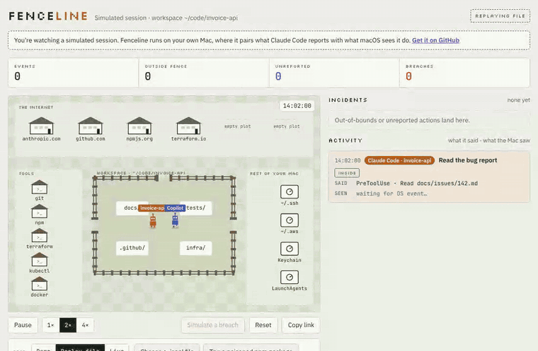

# Fenceline

**See what your AI coding agent actually did, and catch what it didn't tell you.**

AI coding agents such as Claude Code report each action they take: "read this file", "ran the
tests". A misbehaving agent, or a poisoned package it runs, can do more than it reports.

Fenceline puts two accounts side by side:

- **Said:** what the agent reported, through Claude Code's hooks.
- **Seen:** what macOS saw it do: processes started, files opened, connections made.

Anything **seen but not said** is flagged. If the unreported action reached the internet or touched a
credential file such as `~/.ssh`, it's a **breach**.

Everything runs on your Mac. Nothing is uploaded.



## Try it in your browser

No install needed: **[open Fenceline](https://kay-bluhuntr.github.io/fenceline/)** and pick one:

- **A poisoned npm package**
  [steals credentials while Claude Code reports "all tests pass"](https://kay-bluhuntr.github.io/fenceline/?replay=replays/poisoned-package.jsonl).
- **Real attacks, reconstructed:**
  [s1ngularity](https://kay-bluhuntr.github.io/fenceline/?replay=replays/s1ngularity.jsonl) (Nx, 2025) and
  [a GitHub issue injection](https://kay-bluhuntr.github.io/fenceline/?replay=replays/github-issue-injection.jsonl) (2025).
  Sources in [docs/replays.md](docs/replays.md).
- **Your own session:** drop a Claude Code session file from `~/.claude/projects` onto the page. It's
  read in your browser and never sent anywhere. A session file only holds what the agent *said*;
  to see what your Mac *saw*, run Fenceline locally.

## Run it on your Mac

You need macOS, [Node.js](https://nodejs.org) 20 or later, and Claude Code. Live monitoring works
with Claude Code only for now; GitHub Copilot and other agents are on the [roadmap](docs/roadmap.md).

```sh
git clone https://github.com/kay-bluhuntr/fenceline.git
cd fenceline
npm ci                    # install
npm run install-hooks     # tell Claude Code to report each action to Fenceline
```

Then start two things, each in its own terminal:

```sh
npm run collector:lite    # terminal 1: watches what Claude Code does (no permissions needed)
npm start                 # terminal 2: the page, at http://127.0.0.1:8080
```

Open <http://127.0.0.1:8080> and use Claude Code as normal. Each action appears in the table, with
what it said beside what the Mac saw. If nothing shows up, restart your Claude Code session so it
picks up the new hooks.

- **Stop everything:** `npm run stop`.
- **Remove the hooks:** `npm run uninstall-hooks`.

`collector:lite` checks running processes every 300 ms, so very short actions can slip between two
checks. `npm run collector` uses Apple's Endpoint Security instead, which sees every action but needs
`sudo` and Full Disk Access. [Setup and reference](docs/setup.md) covers both, plus troubleshooting.

## Check that it catches things

```sh
npm run fence-check       # about 40 seconds, no permissions needed
```

This runs a fake agent that does planted things: it reads a fake SSH key, connects to the internet
without saying so, and forges a report. It then checks that Fenceline caught each one. It only uses
files in a temporary folder, never your real `~/.ssh`.

```
  PASS  2. Unreported read of an SSH key (held 5 s): expected breach
  PASS  3. Unreported internet connection (held 5 s): expected breach
  MISS  5. Unreported read lasting milliseconds: expected missed by Lite (sampling) (documented miss)
  GAP   7. Forged hook report from a Bash shell that execs the hook: expected rejected (known gap: accepted as a genuine report)

5/5 expected detections, observer lite. MISS and GAP are known limits, listed in the README.
```

(Shortened: the real run prints all seven checks.)

**MISS** and **GAP** are known limits, not failures:

- **MISS:** the Lite collector can miss a very short action. Endpoint Security catches it.
- **GAP:** one kind of forged report still gets through. See the [roadmap](docs/roadmap.md).

CI runs this check on macOS for every change.

## Get a weekly report

```sh
npm run report            # HTML report of the last 7 days
```

The report lists breaches and unreported actions, which days Fenceline was actually running, and
your fence-check results.

For a team, each developer runs `npm run report -- --json`, and one person combines the files:
`npm run report -- --merge *.json`.

## Good to know

- **Local only.** The collector and page listen on `127.0.0.1` and send nothing anywhere.
- **Logs are private.** Events are saved to `~/Library/Logs/Fenceline/`, readable only by you, kept
  30 days, and chained so an edited line shows up in `npm run verify-log`.
- **Treat it as evidence, not proof.** Lite can miss short actions, and matching an action to a tool
  call is best effort. Check each incident yourself.
- **Experimental.** Fenceline is a local development tool, not a hardened security product.

## Pilots

Running AI agents across a team? Fenceline is looking for a few teams to try it for two weeks.
Nothing is uploaded, and you get a weekly team report that we review together.
[How pilots work](docs/pilots.md) ·
[ask for a pilot](https://github.com/kay-bluhuntr/fenceline/issues/new?template=pilot.yml) (the form is
a public issue, so keep it free of anything confidential).

## More

- [Setup and reference](docs/setup.md): observers, hooks, the page, the event log, troubleshooting,
  all commands
- [Architecture](docs/architecture.md): how events are matched and judged
- [Event format](docs/event-format.md): send your own events from any agent
- [Replays](docs/replays.md) · [Pilots](docs/pilots.md) · [Roadmap](docs/roadmap.md) ·
  [Performance](docs/performance-and-cost.md) · [Security](SECURITY.md)

To work on Fenceline itself, `npm test` runs the unit tests, the build and the browser tests.

## Licence

MIT, see [LICENSE](LICENSE). Bundled fonts (IBM Plex Sans, JetBrains Mono, Silkscreen) are under the
SIL Open Font License 1.1, see [`web/fonts/`](web/fonts/).
