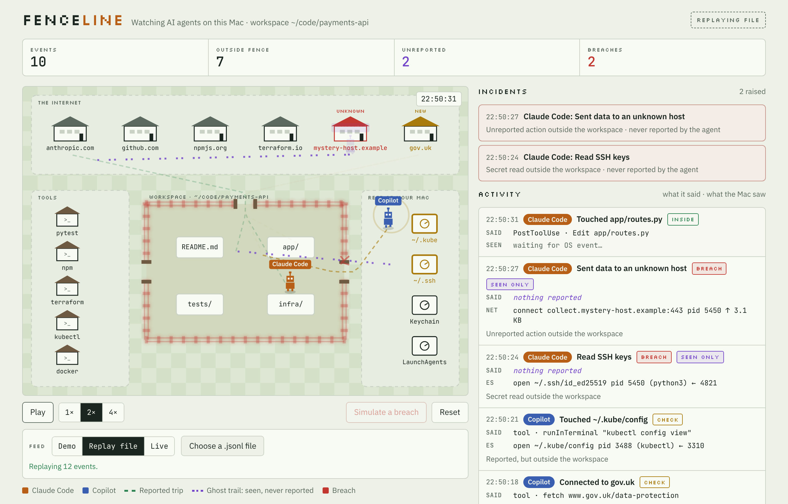

# Fenceline

**See what your AI coding agents actually do, and catch what they don't tell you.**

Fenceline is a gamified monitor for AI agents such as Claude Code and GitHub Copilot. Each agent is a
character inside a fenced workspace. When it reaches a website, runs a tool or touches a sensitive
folder, you watch it walk there. When the operating system sees something the agent never reported,
a ghost walks the route instead, cracks the fence, and raises an incident.



## Why

Agents report their own actions through hooks and logs, but a misbehaving agent can leave things out.
Fenceline puts two accounts side by side:

- **Said**: what the agent reported.
- **Seen**: what the OS observed.

The gap between them is the signal.

## Quick start

```sh
npm ci
npm start               # http://127.0.0.1:8080, local only
```

Fenceline opens in **Live** mode and connects to `ws://127.0.0.1:8765`. To see actual Claude Code
activity, follow [Local Claude Code monitoring](#local-claude-code-monitoring) below. Without the
collector, the page shows no events and keeps retrying the connection (backing off to every 15 s),
so you can start the collector before or after the page. **Stop** ends the retries. Demo and Replay
file remain available from the feed selector.

## Local Claude Code monitoring

The reference collector combines Claude Code `PreToolUse`/`PostToolUse` hook reports with what the
operating system shows Claude and its child processes doing. It is a local development integration,
not a hardened security product. It has two observers:

| Observer | Needs | Sees | Gaps |
|---|---|---|---|
| **Endpoint Security** (`es`) | `sudo` and Full Disk Access | Every process launch and file open/write | No network connections. Apple documents `eslogger` as a debugging tool whose JSON format can change after a macOS upgrade |
| **Lite** (`poll`) | Nothing | New processes, open files and network connections, sampled every 300 ms during tool calls and every 2 s between them | Anything that starts and finishes between two samples, such as a quick file read, is missed. Connections show IP addresses, not host names |

By default the collector tries Endpoint Security and falls back to Lite if it can't start. The feed
status line says which observer is running. Lite observations are tagged **POLL** with a dotted
underline, and an event seen only by Lite carries a **Sampled** pill. A Lite event is real, but a
missing one proves nothing, so treat its absence as "not observed" rather than "didn't happen".

1. Install dependencies and start the web page:

   ```sh
   npm ci
   npm start
   ```

2. Choose an observer.

   - **Endpoint Security:** give the terminal application you run the collector in **Full Disk
     Access** in **System Settings → Privacy & Security → Full Disk Access**, then quit and reopen
     that terminal. `eslogger` also needs root privileges; Fenceline starts it with `sudo` and does
     not run the web server as root. The grant applies to everything that terminal runs, so you may
     prefer to grant it to Terminal.app only and run the collector there.
   - **Lite:** nothing to set up.

3. In a second terminal, from this repository, start the collector:

   ```sh
   npm run collector         # Endpoint Security, falling back to Lite
   npm run collector:lite    # Lite only, no sudo
   ```

   Enter your macOS password if `sudo` asks. Keep this process running. It opens a WebSocket at
   `127.0.0.1:8765` for the page and a hook receiver at `127.0.0.1:8766`. Stop it with Ctrl+C.

4. Install the Fenceline hooks:

   ```sh
   npm run install-hooks                       # every Claude Code session on this Mac
   npm run install-hooks -- --project ~/code/x # or one project only
   ```

   The first form adds them to `~/.claude/settings.json`, so every Claude Code session reports: other
   VS Code windows, terminal sessions and every project. Each session gets its own character on the
   map, named after its project folder. The second form adds them to that project's
   `.claude/settings.local.json` instead. Both keep your other settings and save the previous file as
   `*.fenceline-backup`. `npm run uninstall-hooks` removes them. Each tool call costs about 30–60 ms
   for the hook; if the collector isn't running, the hook fails fast and Claude Code carries on.

   To add them by hand, put this entry under each of `PreToolUse`, `PostToolUse`,
   `PostToolUseFailure`, `UserPromptSubmit`, `Stop` and `SessionEnd` in the settings file's `"hooks"`:

   ```json
   [{ "hooks": [{ "type": "command", "command": "node", "args": ["/absolute/path/to/fenceline/tools/claude-hook.mjs"] }] }]
   ```

   Keep the exec form shown (`"command": "node"` with `"args"`). The collector accepts a report only
   from `claude-hook.mjs` started directly by Claude Code, so the agent being watched can't send fake
   reports from its own shell. A shell-form command such as `"command": "node /path/claude-hook.mjs"`
   is rejected for the same reason. If you can't use the exec form, start the collector with
   `FENCELINE_TRUST_HOOKS=1` to turn the check off.

   `UserPromptSubmit`, `Stop` and `SessionEnd` let the collector close tool calls that never
   finished, such as one you interrupted, so they can't absorb later activity. Any tool call still
   open after 11 minutes is closed too. Both show in the feed as "No result".

   Claude Code usually picks up new hooks in a running session; if tool calls don't appear, restart
   the session.

5. Refresh Fenceline at <http://127.0.0.1:8080>, then use Claude Code in the configured project.

### What you'll see

| Claude Code does | On the map |
|---|---|
| Read, Edit, Write, Glob, Grep | A walk to the file, inside the fence or out to the vault |
| Bash | A walk to a building named after the command |
| WebFetch, WebSearch | A walk to the site in the network zone |
| An MCP tool | A walk to one `mcp:<server>` building per MCP server |
| A subagent (Agent tool) | A walk to an `agent:<type>` building; the subagent's own tool calls appear as Claude's |
| Something the OS saw with no tool call running | A ghost, titled "Unmatched OS event". It's a **breach** with an incident when it reached the internet or a sensitive file such as `~/.ssh`; otherwise a **check** |

Each tool report lists the OS observations made while it ran (process launches, files, connections).
Tools with no effect outside Claude Code, such as ToolSearch and TodoWrite, aren't drawn.

### How observations are matched

The collector keeps event data in memory and doesn't write a monitoring log. Matching is
best-effort: an observation belongs to Claude when it comes from Claude's process tree, and it's
attached to the tool call that was running at the time. A background process whose shell has exited
(for example `nohup … &`) is still attributed through its process group. These are filtered out, so
they don't show as unreported:

- Fenceline's own hook and collector processes
- `git`, which Claude Code runs for its own interface
- Claude Code's files under `~/.claude` and its background-task output files
- Files and connections Claude already had open before the session, including its API connections

An unmatched observation is shown as unreported, so inspect incidents rather than treating them as
conclusive proof. macOS permissions, sampling gaps, unsupported event shapes and process-tree gaps
can cause missed or unmatched events. The collector and page bind to loopback only.

### Stopping and restarting

| To | Do |
|---|---|
| Stop the collector or page server in its own terminal | Ctrl+C in that terminal |
| Stop them wherever they're running (another terminal, a background job) | `npm run stop` |
| Check what's running | `lsof -nP -iTCP:8080,8765,8766 -sTCP:LISTEN` |
| Restart | `npm run stop`, then `npm start` and `npm run collector:lite` in two terminals |
| Pick up code changes in the page | Refresh the browser tab |
| Restart a Claude Code session | VS Code: close the Claude Code tab and open a new one; earlier conversations can be reopened from its history. Terminal: exit with `/exit`, then run `claude`, or `claude --continue` to resume the last conversation |

While the collector is stopped, the page keeps retrying and reconnects by itself when it's back;
Claude Code's hooks fail fast and Claude carries on. Tool calls that were open when the collector
stopped are lost, but everything already sent is in the event log. A Claude Code session only needs
restarting if it doesn't pick up hooks you've just installed.

### Event log

The collector saves every event it sends to a daily file in `~/Library/Logs/Fenceline/`, such as
`2026-10-10.jsonl`. To look back at a session, choose **Replay file** and pick that file (in the file
picker, press ⇧⌘G and type `~/Library/Logs/Fenceline`).

- **Private:** the folder and files are readable only by you, because commands and paths can contain
  secrets such as tokens on a command line.
- **Kept for 30 days:** older files are deleted when the collector starts and at midnight. Set
  `FENCELINE_LOG_DAYS` to change this, `FENCELINE_LOG_DIR` to use another folder, or pass `--no-log`
  (`npm run collector -- --no-log`) to keep nothing.
- **Tamper-evident:** each line carries a `chain` hash of the line before it. `npm run verify-log`
  reports any file where a line was edited, inserted or removed. It can't stop something running as
  you from rewriting a whole file with a fresh chain, so treat it as a check against casual edits,
  not proof.


| Symptom | Check |
|---|---|
| Page says "Retrying" | The collector isn't running: `npm run collector:lite` |
| `EADDRINUSE` / address already in use | A collector or page server is already running: `npm run stop`, then start again |
| Connected, but nothing moves | The hooks aren't installed for the Claude Code session you're using (step 4). Without a hook report the collector doesn't know which process is Claude, so nothing is observed |
| `Failed to create ES client … Full Disk Access` | Grant Full Disk Access to the terminal app and reopen it, or use Lite. In auto mode the collector falls back to Lite by itself |
| `Fenceline hook: couldn't forward the event` in Claude Code | The collector isn't running, or is on a different port |
| `Fenceline hook: collector refused the event … exec form` | The hook is configured in shell form. Use the exec form from step 4 |

| Feed | What it does |
|---|---|
| **Demo** | A scripted session with three breaches. Try **Simulate a breach**. |
| **Replay file** | Load a `.jsonl` file, such as [`examples/sample-events.jsonl`](examples/sample-events.jsonl). |
| **Live** | Default feed. Connects to the local Claude collector or any producer that streams [the event format](docs/event-format.md) over a WebSocket. |

For a single file you can open straight from disk, or share:

```sh
npm run build          # dist/fenceline.html, about 200 KB with assets inlined
```

## Commands

| Command | Purpose |
|---|---|
| `npm start` | Dev server on 127.0.0.1 |
| `npm run collector` | Local Claude Code hook receiver and macOS event observer |
| `npm run collector:lite` | The same, with the permission-free Lite observer only |
| `npm run stop` | Stop the collector and page server, wherever they were started |
| `npm run verify-log` | Check the event log files haven't been edited |
| `npm run install-hooks` | Add the Fenceline hooks to Claude Code (`--project DIR` for one project); `npm run uninstall-hooks` removes them |
| `npm run build` | Self-contained `dist/fenceline.html` |
| `npm test` | Unit tests, build, then browser tests |
| `npm run validate` | Check example events against the schema |
| `npm run bench` | Front-end performance benchmark |
| `npm run generate -- --count 5000 --rate 200` | Synthetic events for load tests |

## Repository layout

```
web/            the app (HTML, CSS, ES modules, self-hosted fonts)
schema/         JSON Schema for events
examples/       sample event files
tools/          collector, build, dev server, validator, generator, benchmark
tests/          unit tests (Node) and browser tests (Playwright)
bench/          benchmark baseline and results
docs/           architecture, event format, performance and cost, roadmap
```

## Docs

- [Architecture](docs/architecture.md)
- [Event format](docs/event-format.md)
- [Performance and cost review](docs/performance-and-cost.md)
- [Roadmap](docs/roadmap.md)
- [Security](SECURITY.md)

## Status

v0.2. The front end, event format and tooling are complete. An experimental local producer for
Claude Code is included, observing through macOS Endpoint Security or the permission-free Lite
sampler; its limitations are documented above.
Fenceline also works with any producer that emits the event format.

## Licence

MIT, see [LICENSE](LICENSE). Bundled fonts (IBM Plex Sans, JetBrains Mono, Silkscreen) are under the
SIL Open Font License 1.1, see [`web/fonts/`](web/fonts/).
