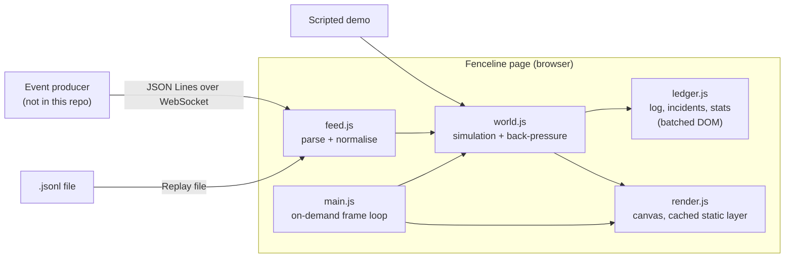

# Architecture

Fenceline is a static web page. It reads a stream of events, each pairing what an AI agent
**said** it did with what the operating system **saw**, and draws them as characters on a map.

## Modules

| File | Responsibility |
|---|---|
| `web/js/config.js` | Limits, allowlist, agents and default map slots. Every performance budget lives here. |
| `web/js/events.js` | Pure functions: parsing, normalising and escaping untrusted event data. Unit-tested in Node. |
| `web/js/world.js` | Map layout, characters, slot recycling, verdicts and back-pressure. |
| `web/js/ledger.js` | Activity log, incidents and stats. One DOM flush per frame. |
| `web/js/render.js` | Canvas drawing. Static scenery is cached offscreen. |
| `web/js/feed.js` | File replay and live WebSocket input. |
| `web/js/demo.js` | The scripted demo session. |
| `web/js/main.js` | Boot, controls and the frame loop that sleeps when nothing changes. |

## Map model

| Zone | Drawn as | Map key |
|---|---|---|
| `fence` | Tiles inside the fenced workspace | First path segment (`src/`, `tests/`) |
| `net` | Buildings on the internet strip | Registrable domain (`api.github.com` becomes `github.com`; `bbc.co.uk` is kept whole) |
| `tools` | Huts | Executable name |
| `vault` | Vaults for sensitive places | `~/.ssh`, `~/.aws`, Keychain, LaunchAgents, or the first two folders |

Slots are limited (4 tiles, 5 tools, 4 vaults, 6 buildings). New keys take over the least
recently used slot that no character is heading to.

## Verdicts

If an event has no `verdict`, Fenceline decides:

1. Unreported (`said: null`) and outside the workspace: **breach**.
2. Reported, but somewhere else on the machine (`vault`): **check**.
3. A domain not on the allowlist, on its first visit: **check**.
4. Everything else: **allowed** or **inside**.

## Design principles

- **Never trust the agent's account alone.** The OS observation is the ground truth, and the diff is the signal.
- **Treat event text as hostile.** File names, commands and hosts can be chosen by the agent being watched.
- **Stay in real time.** When events outpace the animation, fast-forward rather than fall behind.
- **Cost nothing when nothing happens.** No frames are drawn while the map is still.
- **Local-first.** No servers and no third-party requests. The dev server binds to 127.0.0.1.
