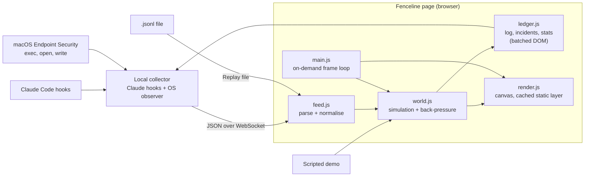

# Architecture

Fenceline is a local browser page with an optional collector. It reads a stream of events, each
pairing what an AI agent **said** it did with what the operating system **saw**, and draws them as
characters on a map.

## Modules

| File | Responsibility |
|---|---|
| `web/js/config.js` | Limits, allowlist, agents and default map slots. Every performance budget lives here. |
| `web/js/events.js` | Pure functions: parsing, normalising and escaping untrusted event data. Unit-tested in Node. |
| `web/js/world.js` | Map layout, characters, slot recycling, verdicts and back-pressure. |
| `web/js/ledger.js` | Activity log, incidents and stats. One DOM flush per frame. |
| `web/js/render.js` | Canvas drawing. Static scenery is cached offscreen. |
| `web/js/feed.js` | File replay and live WebSocket input. |
| `web/js/demo.js` | The scripted demo session. |
| `web/js/main.js` | Boot, controls and the frame loop that sleeps when nothing changes. |
| `tools/collector.mjs` | Local WebSocket + hook receiver; runs an observer and correlates observed events with Claude Code tool hooks. |
| `tools/observe-lite.mjs` | Permission-free observer: samples `ps` and `lsof` for the Claude process tree. |
| `tools/claude-hook.mjs` | Forwards Claude Code pre/post tool events to the local collector. |

## Map model

| Zone | Drawn as | Map key |
|---|---|---|
| `fence` | Tiles inside the fenced workspace | First path segment (`src/`, `tests/`) |
| `net` | Buildings on the internet strip | Registrable domain (`api.github.com` becomes `github.com`; `bbc.co.uk` is kept whole) |
| `tools` | Huts | Executable name |
| `vault` | Vaults for sensitive places | `~/.ssh`, `~/.aws`, Keychain, LaunchAgents, or the first two folders |

Slots are limited (4 tiles, 5 tools, 4 vaults, 6 buildings). New keys take over the least
recently used slot that no character is heading to.

## Verdicts

If an event has no `verdict`, Fenceline decides. A breach means the agent reached the internet, or
touched credentials or a persistence point, without reporting it. Other unreported actions are worth
a look but routine (build tools, test runners, background processes), so they're a check.

| Action | Reported | Unreported (`said: null`) |
|---|---|---|
| Inside the workspace (`fence`) | inside | inside |
| A local tool or process (`tools`) | allowed | **check** |
| A file elsewhere on the machine (`vault`) | **check** | **check** |
| A sensitive file: SSH, AWS, GPG, kube, Docker, `gh`, `.netrc`, registry tokens, Keychain, LaunchAgents, browser logins | **check** | **breach** |
| A private network address or local host name (10.x, 172.16–31.x, 192.168.x, 100.64–127.x, `.local`) | allowed | **check** |
| An internet address or domain (`net`) | allowed, or **check** on a first visit to a domain not on the allowlist | **breach** |

Only breaches raise an incident and sound the fence alarm. An unreported action always walks as a
ghost, whatever its verdict.

## Design principles

- **Never trust the agent's account alone.** The OS observation is the ground truth, and the diff is the signal.
- **Treat event text as hostile.** File names, commands and hosts can be chosen by the agent being watched.
- **Stay in real time.** When events outpace the animation, fast-forward rather than fall behind.
- **Cost nothing when nothing happens.** No frames are drawn while the map is still.
- **Local-first.** No remote servers or third-party requests. The dev server and optional collector bind to 127.0.0.1.

The reference collector is experimental. Its Endpoint Security observer needs root and Full Disk
Access, its `eslogger` JSON format is not stable, and it sees no network connections. Its Lite
observer needs no permissions and sees connections, but samples, so short-lived actions are missed.
Correlation uses process ancestry plus the tool-hook time window. A background process whose shell
has exited is reparented to launchd; it is still attributed to Claude through its process group, when
that group was seen under Claude or the process started during one of Claude's tool calls. Filtered
out: Fenceline's own hook and collector processes, `git` run directly by Claude Code for its UI,
Claude Code's bookkeeping files under `~/.claude` and its background-task output files, and handles
Claude already held before a session. MCP calls are drawn as one `mcp:<server>` building per server,
and subagents as `agent:<type>`. See
[Local Claude Code monitoring](../README.md#local-claude-code-monitoring) for setup and limitations.
